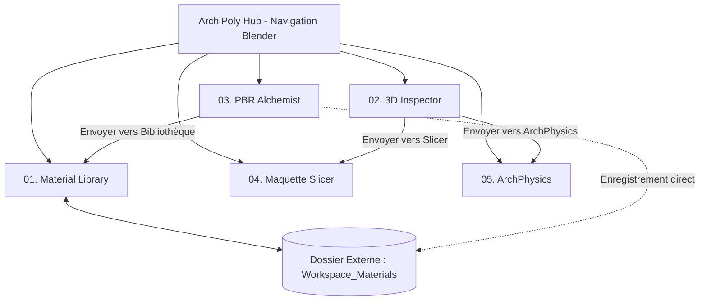

# ArchiPoly — Studio 3D d'Architecture

[](LICENSE)
[](https://www.electronjs.org/)
[](https://threejs.org/)
[](https://expressjs.com/)
[](#compilation-et-distribution)

> **Suite logicielle de bureau unifiée, modulaire et open-source pour la création 3D architecturale, la gestion de matériaux PBR, le tranchage physique de maquettes et l'ingénierie du bâtiment.**
>
> *Unified, modular, and open-source desktop software suite for architectural 3D creation, PBR material management, physical scale model slicing, and building physics engineering.*

---

## Sommaire / Table of Contents

- [Français](#version-française)
  - [Présentation](#présentation)
  - [Architecture Unifiée (Navigation façon Blender)](#architecture-unifiée-navigation-façon-blender)
  - [Les 5 Espaces de Travail (Workspaces)](#les-5-espaces-de-travail-workspaces)
  - [Optimisation GPU & Passerelles de Données](#optimisation-gpu--passerelles-de-données)
  - [Compatibilité d'Écriture & Gestion du piège ASAR](#compatibilité-décriture--gestion-du-piège-asar)
  - [Installation & Démarrage Développeur](#installation--démarrage-développeur)
  - [Compilation de l'Exécutable (.exe)](#compilation-de-lexécutable-exe)
  - [Guide d'Utilisation](#guide-dutilisation)
- [English](#english-version)
  - [Overview](#overview)
  - [The 5 Workspaces](#the-5-workspaces)
  - [GPU Lifecycle & Inter-Module Bridges](#gpu-lifecycle--inter-module-bridges)
  - [Developer Setup](#developer-setup)
  - [Packaging to Windows Executable (.exe)](#packaging-to-windows-executable-exe)
- [Licence & Contributions](#licence--contributions)

---

# Version Française

## Présentation

**ArchiPoly** regroupe sous une seule interface de bureau native (Electron 1680×1000 px, thème sombre architectural `#0e0f11`) l'ensemble de la chaîne de travail numérique des architectes, designers d'espace et artistes 3D :
1. **Material Library** : Exploration et application de matériaux PBR haute résolution classés par catégories.
2. **3D Inspector** : Inspection universelle et contrôle géométrique de fichiers 3D complexes (GLTF, OBJ, FBX, STL, DAE, PLY).
3. **PBR Alchemist** : Synthèse photo-vers-PBR sans couture (Seamless) assistée par algorithmes mathématiques (Sobel 3×3, Delighter).
4. **Maquette Slicer** : Tranchage plan-maillage et préparation de maquettes physiques pour découpe laser (SVG & DXF).
5. **ArchPhysics** : Calculs réglementaires de thermique du bâtiment (ISO 6946 / ISO 13790 avec Heatmap 3D) et de résistance des matériaux (Euler-Bernoulli / Eurocodes).



---

## Architecture Unifiée (Navigation façon Blender)

Inspiré de l'ergonomie de **Blender**, ArchiPoly remplace les fenêtres multiples par une barre d'onglets supérieure horizontale fluide permettant de basculer instantanément sans rechargement :

| Onglet | Espace de Travail | Raccourci | Rôle Principal |
|---|---|:---:|---|
| **01** | `Material Library` | <kbd>Alt</kbd> + <kbd>1</kbd> | Catalogue et visualiseur PBR par catégories |
| **02** | `3D Inspector` | <kbd>Alt</kbd> + <kbd>2</kbd> | Visionneuse universelle, calques et damier UV |
| **03** | `PBR Alchemist` | <kbd>Alt</kbd> + <kbd>3</kbd> | Laboratoire photo vers textures PBR Seamless |
| **04** | `Maquette Slicer` | <kbd>Alt</kbd> + <kbd>4</kbd> | Découpeur de maquettes physiques & exports SVG/DXF |
| **05** | `ArchPhysics` | <kbd>Alt</kbd> + <kbd>5</kbd> | Bilan thermique ISO & dimensionnement RDM poutres |

---

## Optimisation GPU & Passerelles de Données

1. **Cycle de Vie WebGL Strict** :
   Chaque espace de travail écoute les événements `ARCHFORGE_SET_ACTIVE`. Lors du changement d'onglet, l'ancien espace suspend sa boucle `requestAnimationFrame`. Seul l'onglet actif sollicite la carte graphique, préservant ainsi la batterie et le GPU (0% de charge sur les 4 onglets en arrière-plan).
2. **Passerelles Inter-Modules (Shared State)** :
   - Depuis **PBR Alchemist**, cliquer sur *"Envoyer vers la Bibliothèque"* écrit les 5 textures générées directement sur disque et demande au catalogue de se rafraîchir à chaud sans rechargement.
   - Depuis **3D Inspector**, les boutons *"📐 Vers Maquette Slicer"* et *"⚡ Vers ArchPhysics"* transmettent le maillage 3D en mémoire vive sans réimportation disque.

---

## Compatibilité d'Écriture & Gestion du piège ASAR

Lorsqu'une application Electron est compilée en `.exe`, son code est enfermé dans une archive virtuelle `app.asar` en lecture seule.

Pour garantir une écriture 100 % fiable :
- **ArchiPoly** n'écrit jamais dans `__dirname`.
- Toutes les textures sont stockées dans le dossier externe `Workspace_Materials` situé à côté de l'exécutable, servi dynamiquement sur `/materials`.
- Un bouton *"📁 Dossier Matériaux"* présent dans l'en-tête permet d'ouvrir ce dossier directement dans l'Explorateur Windows.

---

## Installation & Démarrage Développeur

### Prérequis
- [Node.js](https://nodejs.org/) v18 ou v20+ (recommandé v24)
- npm v10+

### Installation
```bash
git clone https://github.com/votre-compte/archipoly.git
cd archipoly
npm install
```

### Lancement en mode développement
```bash
npm start
```

---

## Compilation de l'Exécutable (.exe)

ArchiPoly est configuré avec **electron-builder** pour générer les paquets Windows 64-bit :

```bash
# Vérifier la structure sans générer les installeurs
npm run pack

# Générer les exécutables de distribution Windows (Portable .exe et Setup NSIS)
npm run dist
```

Les exécutables générés se trouvent dans le dossier `dist/` :
- `ArchiPoly-Portable-1.0.0.exe` : Exécutable autonome sans installation (prêt à l'emploi sur clé USB).
- `ArchiPoly Setup 1.0.0.exe` : Installateur Windows standard créant le raccourci Bureau et le menu Démarrer.

---

# English Version

## Overview

**ArchiPoly** unites the complete architectural 3D creation and physical computing pipeline under a single native desktop interface (Electron 1680×1000 px, dark architectural aesthetic `#0e0f11`):
1. **Material Library**: PBR texture catalogue with automatic suffix normalization.
2. **3D Inspector**: Universal high-performance 3D viewer, UV checkerboard, layers & metrics.
3. **PBR Alchemist**: Photo-to-seamless PBR texture lab with real-time 3D preview.
4. **Maquette Slicer**: Geometric mesh slicer for laser-cutting physical models (SVG & DXF).
5. **ArchPhysics**: Building thermal envelope analysis (ISO 6946 / 13790) & beam structural mechanics (Euler-Bernoulli / Eurocodes).

```bash
# Clone repository
git clone https://github.com/your-account/archipoly.git
cd archipoly

# Install dependencies & run
npm install
npm start

# Build standalone Portable .exe and NSIS Setup installer
npm run dist
```

---

## Licence & Contributions

Ce logiciel est distribué sous licence libre **GNU General Public License v3.0 (GPLv3)**.
Les contributions, rapports de bugs et propositions d'amélioration sont les bienvenus via les Issues et Pull Requests GitHub.

*Copyright (C) 2026 ArchiPoly Contributors.*
